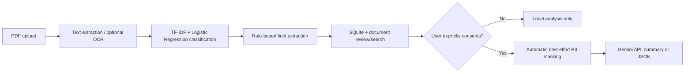

# ExtractIQ

[](https://github.com/shashwatt22/ExtractIQ/actions/workflows/gemini-tests.yml)
[](https://github.com/shashwatt22/ExtractIQ/actions/workflows/expanded-invoice-benchmark.yml)

**Document Intelligence and Information Extraction Platform**

ExtractIQ is a document processing application that converts unstructured PDFs into organized, searchable information. It supports invoices, contracts, financial statements, and court filings, helping users extract important details without manually reviewing entire documents.

**[Live Application](https://extractiq-ai.streamlit.app/)**

## Features

- **Document Classification:** Identifies document types using TF-IDF, Logistic Regression, and keyword-based classification.
- **Information Extraction:** Extracts names, dates, amounts, payment terms, and other relevant fields.
- **Document Search:** Searches uploaded documents using TF-IDF-based retrieval.
- **Question Answering:** Retrieves relevant information and text excerpts from uploaded documents.
- **Table Extraction:** Extracts structured tables from supported PDF layouts.
- **Source Highlighting:** Highlights extracted information within the original PDF when location data is available.
- **Confidence Scoring:** Displays confidence indicators and identifies extraction sources.

## Tech Stack

| Component | Technologies |
|---|---|
| Language | Python |
| Frontend | Streamlit |
| Backend | FastAPI |
| Machine Learning | Scikit-learn, TF-IDF, Logistic Regression |
| PDF Processing | pdfplumber, pypdfium2 |
| Database | SQLite |
| Document Retrieval | TF-IDF, optional ChromaDB |
| Deployment | Streamlit Community Cloud |

## Architecture

```text
PDF Upload
    |
Text Extraction & Processing
    |
Document Classification
    |
Field & Table Extraction
    |
Confidence-Based Result Merging
    |
Storage & Document Indexing
    |
Search, Results & Source Highlighting
```

The hosted application uses the lightweight processing pipeline, which runs directly within Streamlit without requiring a separate FastAPI server.

## Getting Started

**Requirements:** Python 3.10+

```bash
git clone https://github.com/shashwatt22/extractiq.git
cd extractiq
pip install -r frontend/requirements.txt
streamlit run frontend/streamlit_app.py
```

The application includes sample documents for testing.

## Project Structure

```text
backend/      APIs, classification, extraction, retrieval
frontend/     Streamlit application and sample documents
models/       Saved classifier and evaluation metadata
training/     Model training scripts
evaluation/   Evaluation scripts and reports
tests/        Automated tests
docs/         Architecture documentation
```

## Limitations

The document classifier was evaluated primarily on synthetic data. Extraction accuracy may vary with unfamiliar document layouts, scanned PDFs, and poor-quality inputs.

Advanced OCR and transformer-based extraction require additional dependencies. The application is intended for demonstration and experimentation rather than production use with sensitive documents.


## Architecture and Gemini consent



On Streamlit Community Cloud the app uses the embedded extraction backend. Gemini is **not called during normal document ingestion** and requires an API key, a positive consent check, and a deliberate Analyze click. The mandatory masking step covers common emails, phone-like numbers, structured IDs, and labeled name/address fields. It is best-effort, not reliable removal of every sensitive identifier.

### Responsible AI and healthcare readiness

- External requests are opt-in; the backend Gemini wrapper rejects calls without consent.
- Prompts treat document text as untrusted evidence, require missing fields to be labeled **Not stated**, and display a verification notice.
- These are partial safeguards, **not** proof that the model cannot hallucinate or that its responses are automatically fact-checked.
- Handling clinical documents or insurance claims would additionally require comprehensive PII/PHI detection and redaction, secure storage and retention rules, access controls, encryption, auditing, provider agreements and relevant legal/security review. **The current app is not approved for sensitive healthcare data.**

### Reproducible evaluation

| Data | Document classification | Field extraction F1 | Scope |
|---|---:|---:|---|
| Original 20-document pilot | 95% | 75.32% | Fictional, independently sourced invoices |
| Expanded 50-document evaluation | 98% | 59.89% | Same source, includes original 20; invoice number and total only |
| External 10-invoice fixture set | 90% | 23.08% | International invoice fixtures, development-set result |

See [50-invoice report](evaluation/results/EXPANDED_50_REPORT.md), [initial 20-invoice report](evaluation/results/HELDOUT_REPORT.md), and [external fixture revisions](evaluation/results/EXTERNAL_INVOICE_REVISION.md). Benchmark JSON includes per-field metrics, exact matches, confusion matrices and observable error categories. These benchmarks are not comparable as before-and-after performance gains.

### Latency and external cost

The 50-PDF lightweight deterministic CI run averaged **0.09 seconds per PDF** without Gemini (runner-dependent). Gemini performs **one content-generation request per explicit Analyze click**; model latency, usage tokens and monetary cost have not been measured. API billing and rate limits depend on the configured Google project.

### Next steps

Test 100+ diverse independently annotated real-document examples, audit OCR behavior on scanned PDFs, and benchmark Gemini-only versus rules-only versus hybrid extraction with a separately labeled evaluation. Add robust PHI/PII controls before any sensitive healthcare use.


## Docker and cloud deployment (demonstration use only)

```bash
docker compose up --build
```

The FastAPI service runs on port 8000 (`GET /health`, `POST /api/documents/upload`, `POST /api/documents/batch`). The Streamlit frontend runs on port 8501. `docker compose` is smoke-tested with both services in [GitHub Actions](https://github.com/shashwatt22/ExtractIQ/actions/workflows/docker-smoke.yml).

**Render:** create a Docker web service pointing at this repository, use the existing `Dockerfile` with `FULL=0`, expose port 8000, set persistent `DOCINTEL_DATA_DIR` and database environment variables, and configure an appropriate persistent disk and TLS endpoint. Streamlit can remain deployed separately.

**AWS:** run the existing container on ECS Fargate or EC2 behind an HTTPS load balancer, use Secrets Manager for external-model keys, CloudWatch for logs and metrics, and a persistent encrypted storage/database service. Do not rely on the ephemeral container filesystem for documents or SQLite state.

**Fly.io:** create a Docker app from this repository, configure a persistent volume for `DOCINTEL_DATA_DIR`, expose port 8000 through TLS, and configure secrets with Fly's secret store.

**Cloud deployment is not performed.** Minimum requirements for an actual deployment: access to a cloud account, preferred region, spending limit, storage/retention policy and authorization to provision services. Never add API secrets to source control.

## New deterministic fixture partition

`python evaluation/generate_diverse_invoices.py` generates 180 **fictional** invoice PDFs with varying layouts, fonts, currencies, date formats, tax/subtotal confusers, and some rasterized scans. The 150-document development partition can be evaluated and used to improve rules; the last 30 PDFs are a **sealed test partition** excluded from development workflows. No accuracy claim is made about this unscored holdout. These fixtures complement, but **do not replace**, diverse independently labeled real-world documents.

## Deployment limitations

External Gemini calls are consent-gated, automatically masked on a best-effort basis, and logged with metadata only. This is not complete PII/PHI redaction or a medical document processing compliance program. The API has basic validation and limits, but production deployment would still require authentication, tenant isolation, secure object storage, audit retention, encryption, threat modeling, and security review.
