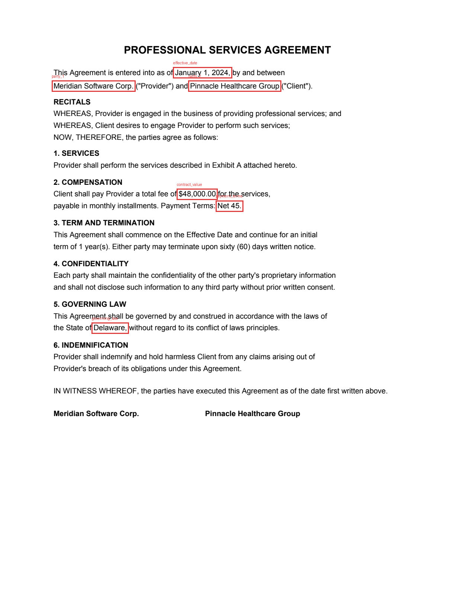
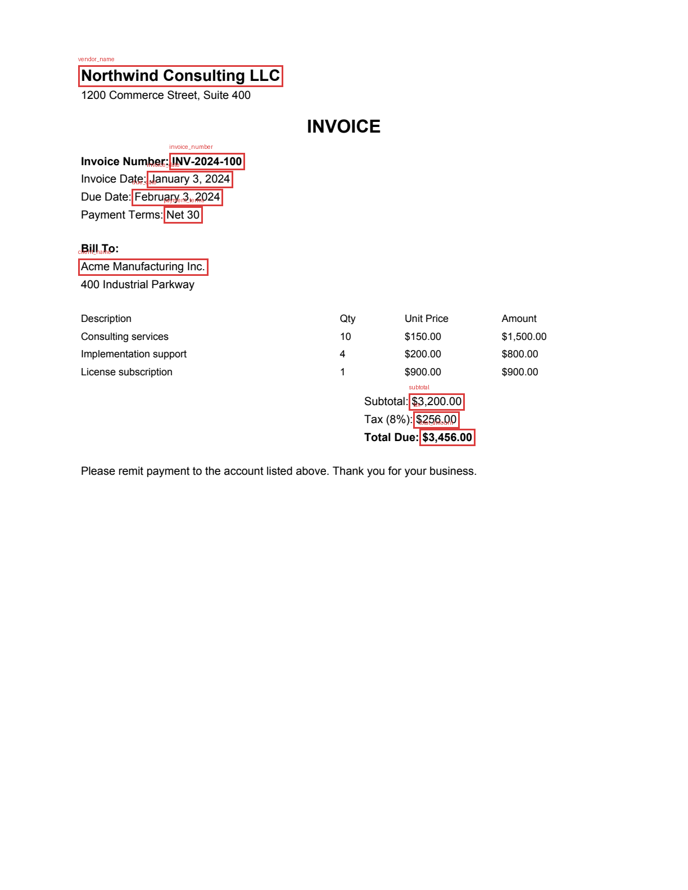

# Document Intelligence

**Live demo:** https://document-intelligence-abhati27.streamlit.app

A multi-modal document understanding system that pulls structured data out of
legal and financial paperwork: contracts, invoices, financial statements, and
court filings, from both native PDFs and scans.

The hosted demo runs the lite path standalone (no separate backend process —
see [Running it](#running-it) and `frontend/embedded.py`): trained classifier,
rules and layout extraction, table extraction, and TF-IDF semantic search. It's
a single free-tier instance, so it can take a few seconds to wake up if it's
been idle, and stored documents reset on redeploy.

The core idea is that no single model should be trusted blindly on documents
where a wrong number has real consequences. So instead of one big model, the
pipeline runs several extractors (LayoutLMv3, Donut, a rules engine, and a
Tesseract/spaCy fallback) and merges their outputs by confidence. Every field
that comes out carries a confidence score, a note on which extractor produced
it, and a bounding box so you can see exactly where on the page it came from.

<p align="center">
  
  
</p>

## What it does

- Detects the document type (invoice, contract, financial statement, court
  document, receipt, or "other") using a supervised classifier I trained on a
  synthetic corpus, cross-checked against a keyword scorer and a zero-shot
  fallback. See [Document classification](#document-classification) below.
- Extracts the fields that matter for each type: parties, dates, amounts,
  payment terms, case numbers, governing law, and so on. Each field records
  which extractor(s) agreed on it and where it sits on the page.
- Pulls out tables as structured JSON, including borderless tables (the usual
  case in invoices and financial statements), which pdfplumber alone misses.
- Handles scans. PDFs with no text layer and plain image uploads get routed
  through Tesseract automatically.
- Answers questions over the uploaded corpus with semantic search (ChromaDB +
  sentence-transformer embeddings). Ask "what are the termination clauses?"
  and get an answer with the source document and page. LLM answer synthesis is
  optional; without an API key it falls back to extractive answers and makes
  no external calls.
- Degrades gracefully. The heavy ML dependencies are all optional at runtime.
  `GET /health` tells you which extractors and which vector backend are
  actually live.

There's a FastAPI backend (async upload, background processing, query, and
dashboard endpoints, all documented at `/docs`), a Streamlit frontend, and a
Docker setup for both a lite and a full-ML image. Four sample documents
(`frontend/samples/`) ship with the app so you can try it without having a
contract or invoice on hand.

## Results

I built a 24-document synthetic test set (6 each of invoice, contract,
financial statement, and court filing, 150 ground-truth fields total) and an
evaluation harness that scores the pipeline against a classic baseline
(Tesseract/text plus spaCy NER, or naive regex matching when spaCy isn't
installed). Matching allows exact, containment, or numeric-equal for amounts.

| Metric | This pipeline | Baseline |
|---|---|---|
| Field extraction accuracy | 100% (150/150) | 49.3% (74/150) |
| Document-type detection | 100% (24/24) | n/a |

That's about a 51-point jump over the baseline (the brief asked for 90%+).
The full per-type and per-field breakdown lands in
`evaluation/results/report.md` and `results.json`.

A note on honesty: those numbers are from the rules-plus-layout path running on
clean native PDFs, which is the deterministic floor of the system. The neural
extractors earn their keep on noisy scans and layouts the regexes have never
seen. Pass `--scanned` to the dataset generator to rasterize a subset and
exercise the OCR path.

To reproduce:

```bash
python evaluation/generate_dataset.py   # 24 PDFs + ground truth
python training/train_classifier.py     # trains the classifier, writes its report
python evaluation/run_eval.py           # pipeline vs baseline
```

## Document classification

Classification is a real trained model, not just keyword matching. Three tiers:

1. A TF-IDF + Logistic Regression classifier (`training/train_classifier.py`)
   trained on ~900 randomized synthetic samples across six classes, including
   an "other" negative class of memos, letters, press releases, and minutes.
   The corpus generator randomizes field labels, entities, amounts, dates, and
   section order, and adds OCR-style character noise to a third of the samples,
   so the model learns each class's vocabulary rather than memorizing a
   template. It gets 100% on a held-out 20% split and 24/24 on the PDF test
   set, which is built from different templates than the training data, so that
   second number is a genuine generalization check.
2. A weighted keyword scorer as a deterministic cross-check that's always
   available with no dependencies.
3. A zero-shot NLI model (`bart-large-mnli`) that only gets consulted when
   there's no trained model on disk and the keyword scorer is unsure.

When the trained model and the keyword scorer agree, confidence gets a small
boost; when they disagree, the more confident one wins with a capped score.
The deciding method is recorded in each result's metadata.

I went with TF-IDF + Logistic Regression over a transformer here on purpose:
these classes are separable by vocabulary, and the linear model gives
calibrated probabilities, sub-millisecond inference, a 432 KB artifact, and
coefficients you can actually inspect to see which terms drove a prediction,
which matters in a legal setting. If more capacity were needed, the ensemble is
set up so a fine-tuned LayoutLMv3 classification head could slot in as another
tier without changing any callers.

The classifier's own report (held-out accuracy, per-class precision/recall,
confusion matrix) is written to `evaluation/results/classifier_report.md`.

## Running it

### Lite (no GPU stack, installs in about 30 seconds)

Runs the full API, the rules and layout extraction, table extraction, the
TF-IDF semantic search fallback, the evaluation harness, and the frontend:

```bash
python3 -m venv .venv && source .venv/bin/activate
pip install -r requirements-lite.txt

uvicorn backend.app.main:app --reload        # API on :8000
streamlit run frontend/streamlit_app.py      # UI on :8501
```

The frontend also works with no backend running at all: if it can't reach the
API it falls back to `frontend/embedded.py`, which calls the same pipeline
in-process. That's what the hosted demo runs on Streamlit Community Cloud —
`pip install -r frontend/requirements.txt && streamlit run frontend/streamlit_app.py`
is the whole deployment.

### Full ML pipeline

Adds LayoutLMv3, Donut, Tesseract + spaCy, and ChromaDB with
sentence-transformers:

```bash
pip install -r requirements.txt
python -m spacy download en_core_web_sm
brew install tesseract       # or: apt-get install tesseract-ocr
```

The model checkpoints (`nielsr/layoutlmv3-finetuned-funsd`,
`naver-clova-ix/donut-base-finetuned-docvqa`) download on first use and can be
overridden in `.env` (see `.env.example`).

### Docker

```bash
docker compose up --build          # lite: API on :8000, UI on :8501
FULL=1 docker compose up --build   # full ML stack
```

### Optional LLM answers

Set `ANTHROPIC_API_KEY` and the `/api/query` endpoint will synthesize answers
from the retrieved excerpts with citations instead of returning extracted
sentences. Without a key nothing leaves the machine.

## API

| Method | Path | Description |
|---|---|---|
| POST | `/api/documents/upload` | Upload a PDF or image, returns 202 and an id; processing runs in the background |
| GET | `/api/documents` | List documents with status |
| GET | `/api/documents/{id}` | Processing status and metadata |
| GET | `/api/documents/{id}/result` | Full extraction: type, fields (with confidence, source, bbox), tables |
| GET | `/api/documents/{id}/page/{n}` | Rendered page PNG, used for the highlight overlay |
| DELETE | `/api/documents/{id}` | Remove a document and its vector chunks |
| POST | `/api/query` | Semantic search / question answering |
| GET | `/api/dashboard/stats` | Corpus statistics |
| GET | `/health` | Which extractors and vector backend are live |

A result looks like this:

```json
{
  "document_type": "contract",
  "document_type_confidence": 0.98,
  "fields": {
    "party_1":        {"value": "Meridian Software Corp.", "confidence": 0.9,  "source": "rules", "page": 1, "bbox": [0.14, 0.20, 0.36, 0.21]},
    "effective_date": {"value": "January 1, 2024",         "confidence": 0.88, "source": "rules", "page": 1, "bbox": [0.38, 0.18, 0.51, 0.19]},
    "governing_law":  {"value": "Delaware",                "confidence": 0.9,  "source": "rules", "page": 1, "bbox": [0.21, 0.56, 0.29, 0.57]}
  },
  "tables": [{"page": 1, "rows": [["Description", "Qty", "Unit Price", "Amount"], ["Consulting services", "10", "$150.00", "$1,500.00"]]}],
  "meta": {"classifier": "ml+keywords", "extractors_used": ["rules"], "is_scanned": false, "num_pages": 1, "processing_seconds": 0.05}
}
```

## How the pipeline fits together

```
PDF / image
   |
   |- 1. Ingest      pdfplumber text + word boxes, pypdfium2 rendering, Tesseract for scans
   |- 2. Classify    TF-IDF + LogReg model, then keyword scorer, then zero-shot NLI
   |- 3. Extract     LayoutLMv3, Donut, Rules, Tesseract+spaCy (all optional except Rules)
   |- 4. Merge       confidence x source-weight vote; agreement across extractors boosts it
   |- 5. Tables      ruled (pdfplumber) + borderless (word-geometry clustering)
   |
   |--> SQLite       status + result JSON
   |--> ChromaDB     chunk embeddings for semantic search
```

The merge math, the coordinate normalization, and the degradation strategy are
written up in [docs/ARCHITECTURE.md](docs/ARCHITECTURE.md).

## Layout

```
backend/app/
  main.py                     FastAPI app + /health
  ml/doc_classifier.py        supervised classifier wrapper (lazy joblib load)
  config.py, database.py, schemas.py
  api/                        documents, query, dashboard routers
  workers/processor.py        background processing job
  pipeline/
    ingest.py                 PDF/image to pages (text + normalized word boxes)
    classifier.py             document-type detection (the three-tier ensemble)
    hybrid.py                 orchestration + confidence merge
    tables.py                 ruled + borderless table extraction
    extractors/               layoutlm.py, donut.py, rules.py, ocr_fallback.py
  rag/
    store.py                  ChromaDB (with TF-IDF fallback) + chunking
    qa.py                     extractive / LLM answer synthesis
frontend/streamlit_app.py     upload, results + overlay, ask, dashboard
frontend/samples/              one sample invoice, contract, statement, filing
frontend/embedded.py          in-process backend for standalone deployment
training/train_classifier.py  corpus generator + TF-IDF/LogReg training
models/                       doc_classifier.joblib + metrics
evaluation/
  generate_dataset.py         24-doc synthetic test set + ground truth
  run_eval.py                 pipeline vs baseline
  results/                    report.md, results.json, classifier_report.md
tests/                        pipeline unit tests + API integration tests
```

## Tests

```bash
pytest tests/ -q
```

22 tests covering the pipeline units, the trained classifier, and a full
upload-to-result API flow.

## Some decisions worth explaining

Why an ensemble instead of one model? Legal and financial extraction needs
calibrated trust more than raw accuracy. Rules are precise on known layouts but
brittle; the vision transformers generalize but can hallucinate. Voting between
them, and raising confidence when they independently agree, gives both coverage
and an honest per-field confidence number.

Why normalized bounding boxes throughout? One coordinate system (0 to 1) feeds
LayoutLMv3's 0-1000 space, the merge step, and the frontend overlay at any
render scale, and it makes OCR words and native-PDF words interchangeable.

Why optional dependencies? A 6 GB torch install shouldn't be the price of
running the API or the eval. Each extractor reports its own availability and
you can see the state at `/health`.

## Limitations and next steps

- The test set is synthetic. Real scans (skew, stamps, handwriting) will lower
  accuracy, which is exactly what the confidence scores are meant to surface.
- The FUNSD/DocVQA checkpoints are generic. Fine-tuning LayoutLMv3 on CUAD for
  contracts or SROIE for receipts is the highest-value next step.
- Background processing is in-process via FastAPI's BackgroundTasks. Swapping in
  Celery or RQ for multi-worker deployments is a one-line change in
  `api/documents.py`.
- Clause-level extraction (termination, indemnification, and so on as spans) is
  currently handled through the query endpoint rather than the field schema.

## License

MIT
